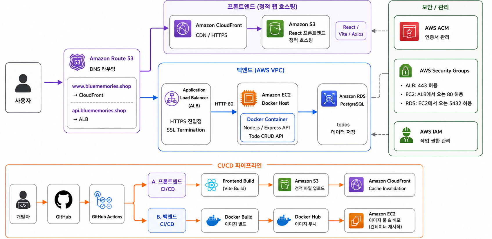
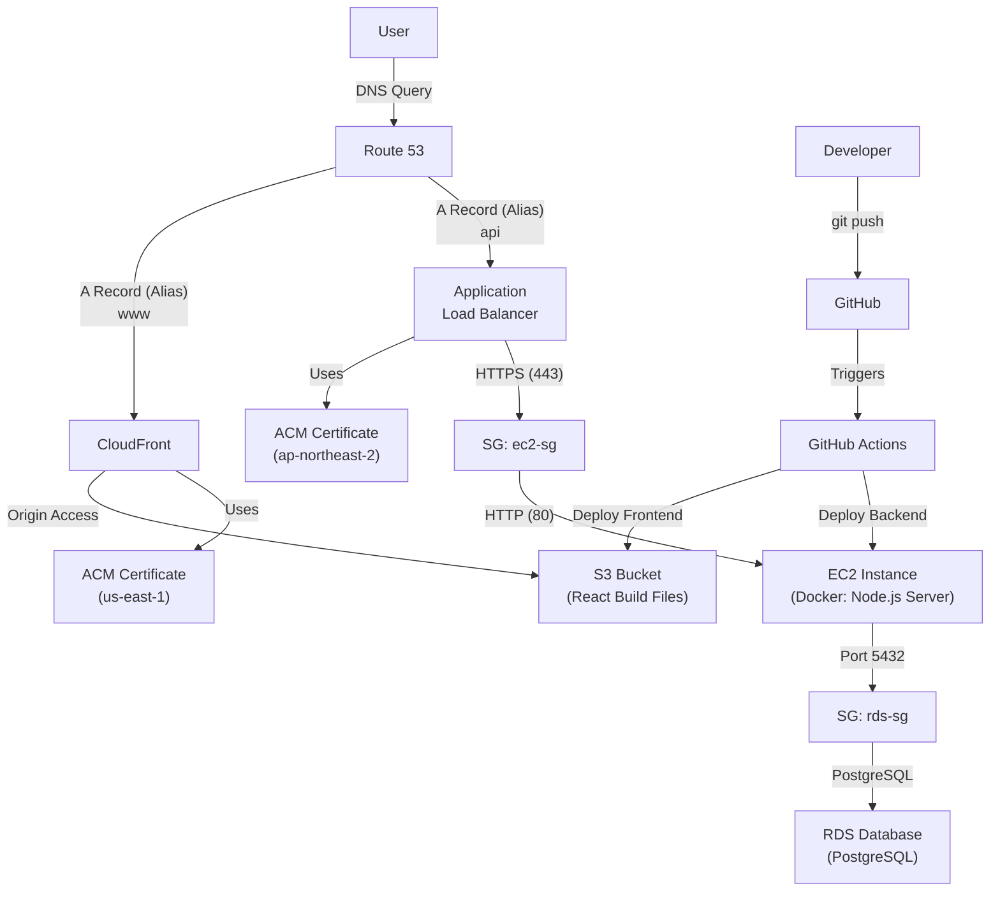

# AWS Deploy · 풀스택 배포 자동화 실습 (API 서버)

> React 프론트엔드와 Docker 백엔드를 AWS에 분리 배포하고 GitHub Actions로 배포 흐름을 자동화한 1인 인프라 실습의 **백엔드 저장소**입니다.
> Node.js/Express Todo API를 Docker 이미지로 빌드해 EC2에 배포하고, ALB·ACM으로 API를 HTTPS로 제공했습니다.



| 기간 | 팀 구성 | 내 역할 |
| --- | --- | --- |
| 2025.08 ~ 2025.09 | 1인 구축 | 인프라 설계 및 배포 자동화 구축 |

**링크** · [포트폴리오 상세](https://portfolio-sys13-9a4d.vercel.app/projects/aws-deploy) · [프론트엔드 저장소 (todo-list-client)](https://github.com/yss9/todo-list-client)

---

## 주요 기능

AWS Deploy 실습은 두 저장소로 나뉩니다. 이 저장소는 API 서버와 백엔드 배포를, [todo-list-client](https://github.com/yss9/todo-list-client)는 React 화면과 S3·CloudFront 배포를 담당합니다.

| 구분 | 내용 | 위치 |
| --- | --- | --- |
| Backend 배포 | GitHub Actions에서 Docker 이미지를 빌드해 Docker Hub에 푸시하고 EC2 컨테이너로 배포 | 이 저장소 |
| Database 연동 | 환경 변수로 RDS PostgreSQL 연결 정보를 주입받고 SSL 옵션으로 연결 | 이 저장소 |
| HTTPS API | ALB·ACM으로 API를 HTTPS로 제공 | AWS 콘솔 구성 |
| DNS 연결 | Route 53으로 프론트엔드·API 도메인 연결 | AWS 콘솔 구성 |
| Frontend 배포 | React(Vite) 빌드 산출물을 S3에 올리고 CloudFront로 배포 | todo-list-client |
| 배포 대상 API | Express + `pg`로 PostgreSQL `todos` 테이블 조회·추가·수정·삭제 | 이 저장소 |

### 배포 대상 API

| Method | Path | 설명 |
| --- | --- | --- |
| `GET` | `/` | 서버 상태 확인 |
| `GET` | `/api/todos` | 전체 Todo 조회 (`id` 오름차순) |
| `POST` | `/api/todos` | Todo 추가. body: `{ "text": string }` |
| `PUT` | `/api/todos/:id` | Todo 수정. body: `{ "text"?: string, "completed"?: boolean }` |
| `DELETE` | `/api/todos/:id` | Todo 삭제 |

- 필수 값이 없으면 `400`, 대상 ID가 없으면 `404`, DB 오류는 `500`을 반환합니다.
- `PUT`은 전달된 필드만 골라 파라미터 바인딩 쿼리를 동적으로 만듭니다. ([server.js](server.js#L81))

## 내가 맡은 부분

1인 실습이라 애플리케이션 코드부터 AWS 리소스 구성까지 직접 진행했습니다. 저장소에서 확인할 수 있는 부분과 AWS 콘솔에서 구성한 부분을 나눠 적습니다.

**저장소에 남아 있는 작업**

- `node:18-alpine` 기반 Dockerfile 작성, 의존성 레이어를 먼저 복사해 빌드 캐시 활용 — [Dockerfile](Dockerfile)
- `main` 브랜치 push 시 이미지 빌드·푸시 후 EC2에 SSH로 배포하는 워크플로 작성 — [.github/workflows/main.yml](.github/workflows/main.yml)
- RDS 연결 정보 환경 변수 주입과 PostgreSQL SSL 옵션 적용 — [server.js](server.js#L19) (문제 해결 2)
- CORS를 모든 출처 허용에서 프론트엔드 CloudFront 도메인만 허용하도록 변경 — [server.js](server.js#L10)
- 배포 대상인 Express·`pg` 기반 Todo CRUD API 작성 — [server.js](server.js)

**AWS 콘솔에서 구성한 작업** (IaC로 관리하지 않아 저장소에는 남아 있지 않습니다)

- Route 53 레코드(`www` → CloudFront, `api` → ALB)
- ALB + ACM 인증서(ap-northeast-2)로 HTTPS(443) 종료 후 EC2(80)로 전달
- Security Group 분리: ALB 443 허용, EC2는 ALB에서 오는 80 허용, RDS는 EC2에서 오는 5432 허용
- RDS PostgreSQL 생성과 `todos` 테이블 준비

## 문제 해결

### 1. Mixed Content — HTTPS 페이지의 HTTP API 차단

- **문제**: CloudFront는 HTTPS로 서빙되는데 EC2 API는 HTTP로 호출하고 있어, 브라우저가 프론트엔드의 API 요청을 차단했습니다.
- **해결**: AWS 콘솔에서 ALB에 ACM 인증서를 연결해 API Endpoint를 HTTPS로 구성하고, 프론트엔드는 배포 Secret의 API URL을 주입받도록 바꿨습니다. EC2 컨테이너는 ALB 뒤에서 HTTP(80 → 3000)로 동작합니다. ([main.yml](.github/workflows/main.yml#L60))
- **결과**: Mixed Content 차단 없이 프론트엔드에서 API를 호출할 수 있게 됐습니다.

### 2. RDS 연결 오류 — 환경 변수와 SSL 확인

- **문제**: 배포 환경에서 PostgreSQL 연결 오류가 발생했습니다.
- **해결**: `docker logs`를 기준으로 DB 환경 변수와 SSL 연결 옵션을 확인했습니다. 워크플로에서 고정값으로 넘기던 `RDS_DB_NAME`·`RDS_PORT`를 Secrets 주입으로 바꾸고 ([main.yml](.github/workflows/main.yml#L65-L66)), PostgreSQL Pool에 SSL 옵션을 추가했습니다 ([server.js](server.js#L25-L27)).
- **결과**: 코드의 연결 설정과 콘솔의 네트워크 설정을 나눠 점검했습니다. Security Group·Secrets의 당시 값은 저장소에 남아 있지 않아 원인을 단정하지 않았습니다.

### 3. CI/CD SSH Timeout — 대안 검토

- **문제**: GitHub Actions 배포 단계에서 EC2 SSH 연결 시간 초과가 발생했습니다.
- **해결**: GitHub-hosted Runner는 고정 공인 IP를 보장하지 않아 특정 IP만 허용하는 EC2 접근 정책과 충돌할 수 있다고 보고, Runner 접속 경로와 EC2 접근 정책을 점검했습니다. 고정 접근 경로가 필요한 경우를 위해 self-hosted Runner 또는 AWS SSM 전환을 검토했습니다.
- **결과**: 현재 워크플로는 GitHub-hosted Runner의 SSH 배포 방식입니다. 당시 연결 로그가 남아 있지 않아 Timeout 원인은 단정하지 않았습니다.

## 기술 스택

| 구분 | 기술 |
| --- | --- |
| Runtime | Node.js 18 (`node:18-alpine`) |
| Framework | Express 4.21.2 (`^4.18.2`) |
| Database | PostgreSQL (`pg` 8.16.3), AWS RDS |
| Middleware | cors 2.8.5 |
| Container | Docker, Docker Hub |
| CI/CD | GitHub Actions (`docker/build-push-action`, `appleboy/ssh-action`) |
| AWS | EC2, ALB, ACM, RDS, Route 53 (프론트엔드 측: S3, CloudFront) |

버전은 `package-lock.json`에 고정된 값입니다.

## 아키텍처

정적 리소스는 S3·CloudFront, 동적 API는 ALB·EC2, 데이터는 RDS로 경로를 분리했습니다.
사용자 요청은 Route 53에서 `www`는 CloudFront로, `api`는 ALB로 나뉘고, ALB가 HTTPS를 종료한 뒤 EC2의 Docker 컨테이너로 전달합니다.
GitHub Actions 코드는 저장소에서 확인할 수 있고, AWS 리소스 연결은 콘솔 구성과 아래 다이어그램으로 관리했습니다.

<details>
<summary>요청 경로 다이어그램 (Mermaid)</summary>



</details>

### 백엔드 배포 흐름

`main` push → GitHub Actions(`ubuntu-latest`) → Docker 이미지 빌드 → Docker Hub에 `<DOCKERHUB_USERNAME>/todo-list-server:latest` 푸시 → EC2에 SSH 접속 → 기존 `todo-app-container` 중지·삭제 → 새 이미지 pull → `-p 80:3000`과 RDS 환경 변수로 컨테이너 실행

워크플로가 사용하는 GitHub Secrets (이름만 표기):
`AWS_ACCESS_KEY_ID`, `AWS_SECRET_ACCESS_KEY`, `AWS_REGION`, `DOCKERHUB_USERNAME`, `DOCKERHUB_TOKEN`, `EC2_HOST`, `EC2_PEM_KEY`, `RDS_USERNAME`, `RDS_PASSWORD`, `RDS_HOSTNAME`, `RDS_DB_NAME`, `RDS_PORT`

## 실행 방법

PostgreSQL 데이터베이스가 필요합니다. 연결 설정에 SSL 옵션이 항상 켜져 있으므로 SSL 연결을 받는 PostgreSQL(예: RDS)을 대상으로 해야 합니다.

### 1. 테이블 준비

[server.js](server.js#L34) 주석에 있는 스키마로 `todos` 테이블을 먼저 만듭니다.

```sql
CREATE TABLE todos (
  id SERIAL PRIMARY KEY,
  text VARCHAR(255) NOT NULL,
  completed BOOLEAN DEFAULT FALSE,
  created_at TIMESTAMP WITH TIME ZONE DEFAULT CURRENT_TIMESTAMP
);
```

### 2. 환경 변수

`.env` 로더를 쓰지 않으므로 셸 환경 변수나 `docker run -e`로 주입합니다.

| 변수 | 설명 |
| --- | --- |
| `RDS_HOSTNAME` | DB 호스트 |
| `RDS_PORT` | DB 포트 |
| `RDS_DB_NAME` | DB 이름 |
| `RDS_USERNAME` | DB 사용자 |
| `RDS_PASSWORD` | DB 비밀번호 |

### 3-a. 로컬 실행

```bash
npm install
npm start   # http://localhost:3000
```

### 3-b. Docker 실행

```bash
docker build -t todo-list-server .
docker run -d -p 80:3000 --name todo-app-container \
  -e RDS_HOSTNAME -e RDS_PORT -e RDS_DB_NAME -e RDS_USERNAME -e RDS_PASSWORD \
  todo-list-server
```

- CORS 허용 출처가 배포된 CloudFront 도메인으로 고정되어 있어, 다른 출처의 브라우저 요청은 차단됩니다. `curl` 같은 도구로는 바로 호출할 수 있습니다.
- 운영 배포는 `main` 브랜치 push 시 [GitHub Actions 워크플로](.github/workflows/main.yml)가 수행합니다.

## 폴더 구조

```
todo-list-server/
├── .github/workflows/main.yml   # Docker 빌드·푸시 + EC2 배포 워크플로
├── docs/images/                 # README 이미지
├── Dockerfile                   # node:18-alpine 기반 이미지
├── .dockerignore
├── .gitignore
├── README.md
├── package.json
├── package-lock.json
└── server.js                    # Express 앱, PostgreSQL Pool, Todo API
```
